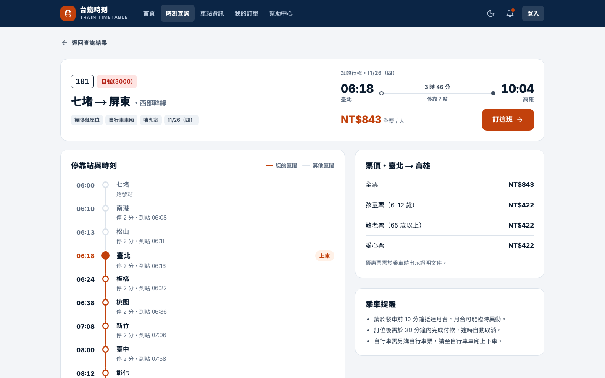
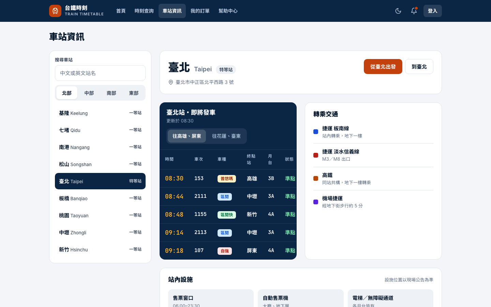
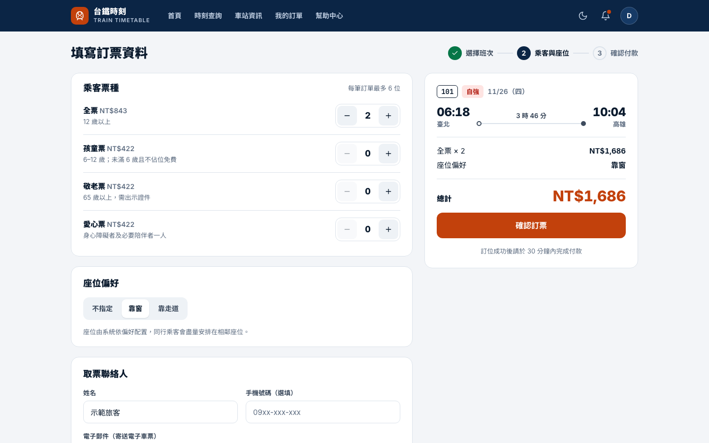
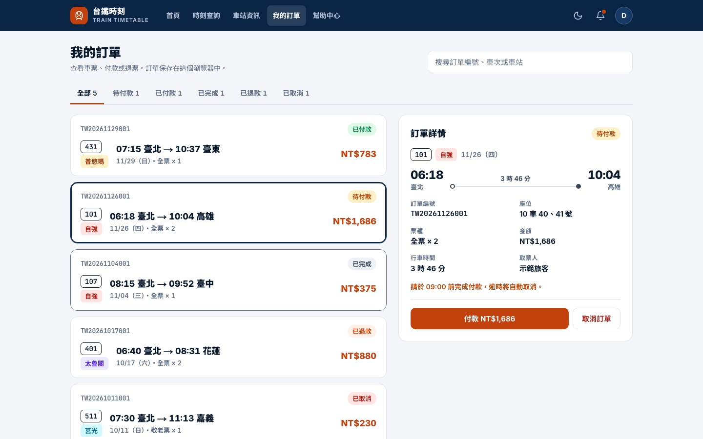
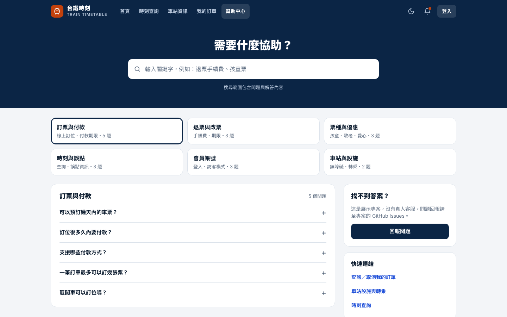
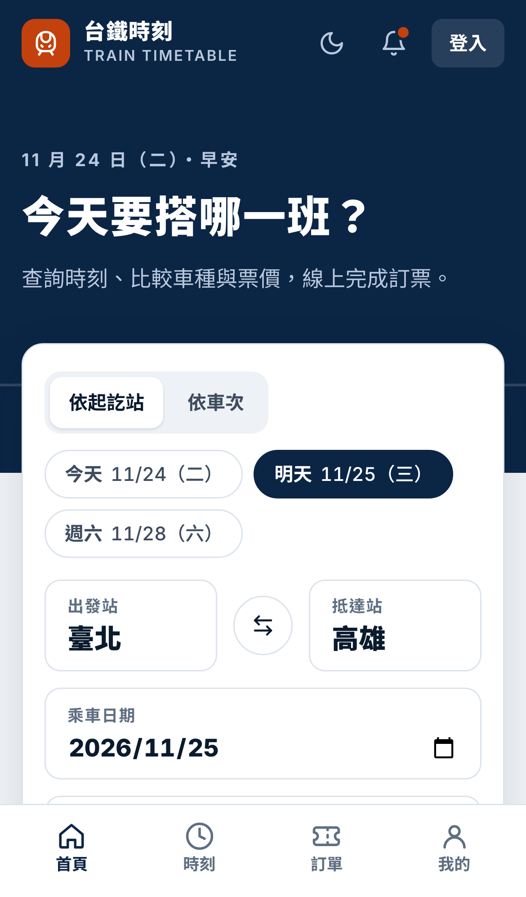
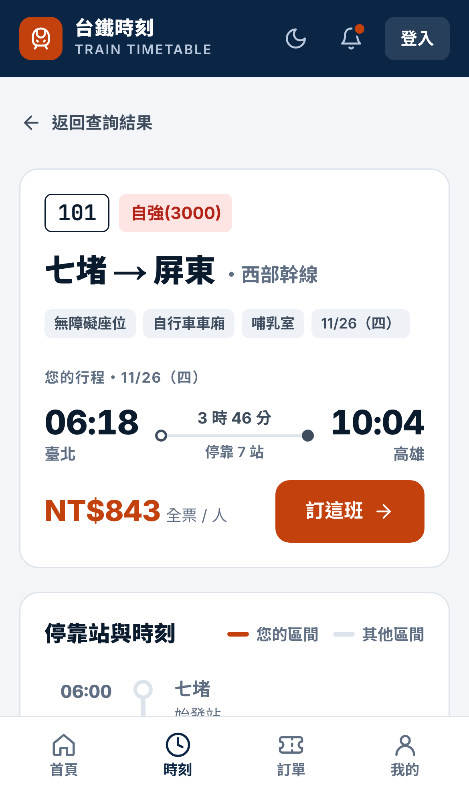

# Trainstation Time Table System（台鐵時刻）

A Taiwan Railway timetable and booking **demo**, built with **Next.js 16 (App Router)**.
You can search trains between stations, see a train's stops on a route timeline, book seats and manage orders. It works on desktop and mobile, in light or dark mode.

**Demo:** [Live Demo](https://trainstation-time-table-gr925.vercel.app)
**Design:** the UI follows the Claude Design canvas *台鐵時刻 · Redesign*: a railway identity with a navy board, a signal-orange accent, departure-board results and a route-line timeline.

> [!IMPORTANT]
> This is a personal portfolio project. It is **not** an official railway service and is not affiliated with or endorsed by Taiwan Railway Corporation (臺鐵) or the Ministry of Transportation and Communications.
>
> - **No real tickets.** Accounts, bookings and payments are simulated. No real ticket is issued, no payment is taken, and no personal data is sent to any server.
> - **Mock timetables by default.** Without TDX keys the site shows generated data that may not match real schedules. Do not use it to plan real trips. Check the official railway website instead.

## Screenshots

All screenshots use mock data and a placeholder account. To regenerate them, see [Regenerating screenshots](#regenerating-screenshots).

| Home: search and departure board | Search results |
|---|---|
|  |  |

| Train detail: route timeline and fares | Station: live board, transfers, facilities |
|---|---|
|  |  |

| Booking | Booking confirmed |
|---|---|
|  |  |

| My orders | Member login |
|---|---|
|  |  |

| Dark mode | Help center |
|---|---|
|  |  |

| Mobile: home | Mobile: results | Mobile: train detail |
|---|---|---|
|  |  |  |

## Features

- **Timetable search** by origin and destination, with swap, a date strip and a departure-time filter, or by train number.
- **Results** you can filter by train type, time of day and services, and sort by departure, duration or fare.
- **Train detail** with a stop timeline that highlights your segment, plus fares per ticket type.
- **Booking flow**: choose passengers by ticket type, seat preference and contact details. Each order gets a 30-minute payment window.
- **My orders**: status tabs (待付款 / 已付款 / 已完成 / 已退款 / 已取消), search, pay, cancel, refund and print.
- **Stations**: a searchable list by region, a departure board split by direction, transfers and facilities.
- **Help center**: categorized FAQ with full-text search across questions and answers.
- **Mock membership**: login, register or browse as a guest. Booking and orders require a member session.
- **Accessibility and theming**: light and dark themes with no flash on load, a responsive layout with a mobile bottom tab bar, and keyboard- and screen-reader-friendly controls.

## Tech Stack

- Next.js 16 (App Router, Server Components, Server Actions, `proxy.ts` route guard)
- React 19, TypeScript (strict)
- Tailwind CSS 4, with design tokens as CSS variables (`app/globals.css`)
- Radix UI (Dialog, Popover) for accessible overlays
- TDX (Transport Data eXchange) API, called on the server only
- Vitest (unit tests) and Playwright (end-to-end tests)
- Hosted on Vercel

## Getting Started

Requires Node.js 20.9+.

```bash
npm install
cp .env.example .env.local   # optional: add TDX keys
npm run dev                  # http://localhost:3000
```

Other scripts: `npm run build`, `npm start`, `npm run lint`, `npm run typecheck`, `npm test`, `npm run test:watch`, `npm run test:e2e`, `npm run screenshots`.

### Environment variables

| Variable | Where | Purpose |
|---|---|---|
| `TDX_CLIENT_ID` / `TDX_CLIENT_SECRET` | server only | TDX OAuth client credentials. Leave them empty to use mock data. **Never prefix with `NEXT_PUBLIC_`.** |
| `USE_MOCK` | server only | `true` forces mock data even when keys are set. |

- **Getting keys:** apply at [TDX 運輸資料流通服務](https://tdx.transportdata.tw/). On Vercel, add them under *Project → Settings → Environment Variables*. Never commit them: every `.env*` file except `.env.example` is git-ignored.
- **Attribution:** when TDX data is shown, the footer credits the source (交通部 TDX 運輸資料流通服務), in line with TDX's data-use terms.
- **`vercel.json`:** pins the framework to Next.js, so an older *Vite* preset in the Vercel dashboard can't override the build output.

## Data Flow

```
Server Components / Server Actions
        │
   lib/data/index.ts  ── TDX configured? ──yes──▶ lib/tdx (token cache + fetch, revalidate 30s–1d)
        │                     │                         │ any error / missing data
        │                     no                        ▼
        └──────────────────────────────────────▶ lib/mock (deterministic timetable)
```

- Every data function returns `{ data, source }`. **Whatever TDX can't provide comes from mock data**, so pages never break.
  - **Whole record:** it falls back (`source: 'mock'`, logged as `[data] … 改用模擬資料`) when TDX returns an error, an empty list or malformed records, or doesn't have the requested train, trip or station.
  - **Single field:** a missing field is filled in while `source` stays `'tdx'`. A missing fare is estimated from mock-network distance. Seat availability always uses the mock value, because TDX doesn't publish it.
- TDX endpoint paths live in `lib/tdx/client.ts` (`TDX_PATHS`).
  - The token endpoint is verified.
  - The timetable, fare and live-board paths follow the TDX v3 Rail/TRA docs. Check them against the TDX Swagger once you have keys.
  - Fare mapping (`pickFare`) is a heuristic until then.
- Mock timetables are deterministic.
  - The same train number always has the same type and stops.
  - Seat availability and delays are seeded by train number and date.
- **Browser storage:** orders, recent searches, favourites and read notices are kept in the browser's `localStorage` (`lib/stores`).
- **Session:** the `ts_session` cookie, set by the Server Actions in `app/actions/session.ts`.

## Security

- **Secrets stay on the server.**
  - TDX credentials are read only in server code (`lib/tdx/client.ts` imports `server-only`) and are never sent to the browser.
  - CI and the build need no secrets; they always run on mock data.
- **No real personal data.**
  - Login accepts any email and password, and nothing is stored on a server.
  - Contact details typed into the booking form stay in that browser's `localStorage`.
- **Session cookie.** `ts_session` is `HttpOnly` and `SameSite=Lax`, and `Secure` in production. It only holds a display name, an email and a guest flag; it is not a credential.
- **Route protection.**
  - `proxy.ts` sends visitors without a member session from `/booking`, `/orders` and `/account` to the login page.
  - The post-login redirect (`?next=`) only accepts same-site paths (`lib/safeNext.ts`). It rejects external URLs, `//host`, `/\host` and control characters, which prevents open redirects. Unit and E2E tests cover this.
- **CI permissions.**
  - Workflows use the built-in `GITHUB_TOKEN` with the least permissions each job needs. There are no personal access tokens.
  - The repository has GitHub secret scanning and push protection enabled.
- **Reporting a vulnerability.** Please don't post vulnerability details in a public issue. Open an issue that only asks for a private contact, and the maintainer will follow up.

## Testing

```bash
npm test             # Vitest, run once
npm run test:watch   # re-run on change
```

Unit tests live in `test/` and need no TDX keys or browser:

- **Data fallback** (`test/data-fallback.test.ts`):
  - TDX failures, empty lists, malformed records and missing trains fall back to mock data.
  - A missing fare is filled in with a distance estimate.
- **TDX client and mappers**: token caching, `USE_MOCK`, HTTP errors, midnight-crossing timetables, fare picking.
- **Mock timetable**: determinism, search order, fares, and board directions (regression for PR #5).
- **Orders store**: id sequence, 30-minute pay window, expiry, refund and cancel, unavailable `localStorage`.
- **Auth**: the `proxy.ts` route guard and session parsing.
- **Docs freshness** (`test/docs-freshness.test.ts`):
  - This README's scripts, environment variables, Node version and workflow list must match `package.json`, `.env.example`, the code and `.github/workflows/`.
  - Update the README in the same change, or the test fails.

### End-to-end tests (Playwright)

```bash
npx playwright install chromium   # first time only
npm run test:e2e                  # builds, starts on :3100 with USE_MOCK=true, runs Chromium
```

Specs live in `e2e/`. They drive a real browser against the production build, in the Asia/Taipei time zone.

- **Search** (`e2e/search.spec.ts`):
  - station picker (台 matches 臺), swap, the same-station error, quick dates;
  - search by train number, and results → train detail.
- **Booking** (`e2e/booking.spec.ts`):
  - the full flow: signed out → login → back to booking → add a passenger → book → pay → my orders (survives a reload) → refund;
  - form validation, and cancelling a pending order.
- **Site** (`e2e/site.spec.ts`):
  - the route guard, guest mode without a redirect loop, and blocking open redirects after login;
  - login validation, and dark mode persisting across a reload;
  - the station board, help search and 404 pages.
- **Mobile** (`e2e/layout.mobile.spec.ts`, Pixel 7): no horizontal scroll on key pages, and the bottom tab bar navigates.

**Invalid train pages return status 200.** `/trains/<invalid>` shows the 404 page with a `noindex` tag. This is standard Next.js behaviour: `(site)/loading.tsx` starts streaming the page before `notFound()` runs. The spec checks for this.

**CI failures:** download the `playwright-report` artifact from the run.

### Regenerating screenshots

```bash
npm run screenshots          # builds, then writes docs/screenshots/*.png
```

`scripts/screenshots.mjs` works like this:

- It starts the production build with `USE_MOCK=true`.
- It fixes the clock at 08:30 Taiwan time on the next day, using `scripts/fake-clock.mjs`, which is only loaded for this script. That keeps the boards full and every run identical.
- It captures desktop, dark-mode and mobile views.
- It signs in with a placeholder account (`demo@example.com`), so no real personal data appears in the images.

## Branching & Deployment

```
feature branch ──(Auto Pull Request)──▶ PR to dev ──(manual merge)──▶ dev
dev ──(Dev to Release: CI, then auto PR + merge)──▶ release   → Vercel Preview
release ──(manual PR + merge)──▶ main                         → Vercel Production
```

Workflows in `.github/workflows/`:

| File | Runs on | What it does |
|---|---|---|
| `ci.yml` | push to any branch except `dev`, manual | lint, typecheck, `npm test`, `npm run build`, `npm run test:e2e` (mock data, no keys needed) |
| `auto-pull-request.yml` | push to a feature branch | opens the PR to `dev` if none exists |
| `dev-to-release.yml` | push to `dev`, manual | runs `ci.yml` first; only if it passes, opens and merges the `dev` → `release` PR |

- **Tokens:** all workflows use the built-in `GITHUB_TOKEN`. Requirement: *Settings → Actions → General → Allow GitHub Actions to create and approve pull requests* must be enabled.
- **No double runs on `release`:** merges pushed with `GITHUB_TOKEN` don't trigger `push` workflows, so the automatic `release` merge doesn't re-run CI. Vercel deploys through its GitHub app, so it is unaffected.
- **No `pull_request` trigger in `ci.yml`:**
  - Same-repo branches are already checked on push, and the result shows on the PR.
  - PRs opened by the bot would only create runs stuck on "approval required".
  - Trade-off: PRs from forks don't run CI automatically.
- **Skipping the release merge:** add `[skip-release]` to a commit message on `dev` to skip the automatic release merge. The release workflow can also be run manually (*Actions → Dev to Release → Run workflow*).

## Project Structure

```
app/
  (site)/            pages with the top bar + mobile tab bar
    page.tsx         home: search, departures board, next trip, favourites, notices
    search/          results for ?from&to&date&after
    trains/[no]/     train detail (?date&from&to)
    booking/         booking form; booking/done/[id] confirmation
    orders/          my orders
    stations/[id]/   station info
    help/            help center
    account/         member center
  login/             login / register / guest
  actions/session.ts mock sign-in / sign-out (Server Actions)
  globals.css        design tokens (light/dark) + component classes
components/          TopBar, SiteChrome, SearchForm, StationPicker, ResultsList, DepartureBoard, BookingForm, OrdersView, …
lib/
  data/              data access facade (TDX → mock fallback)
  tdx/               TDX client and response mappers
  mock/              mock network (stations, lines, service templates) and timetable generator
  stores/            localStorage-backed client stores (orders, prefs)
  safeNext.ts        same-site check for the post-login redirect
  board.ts           departure-board helpers (direction labels)
  format.ts, trainTypes.ts, types.ts, faq.ts, notices.ts, stationInfo.ts
proxy.ts             protects /booking, /orders, /account
test/                Vitest unit tests (see Testing)
e2e/                 Playwright end-to-end specs
scripts/             screenshot generator (see Regenerating screenshots)
docs/screenshots/    images used in this README
```

## License

This project is licensed under the MIT License - see the [LICENSE](./LICENSE) file for details.

The MIT License covers this project's source code only. Railway names, station names and any official marks belong to their respective owners. TDX data, when used, is subject to the TDX terms of use.

## Author

Gorman
