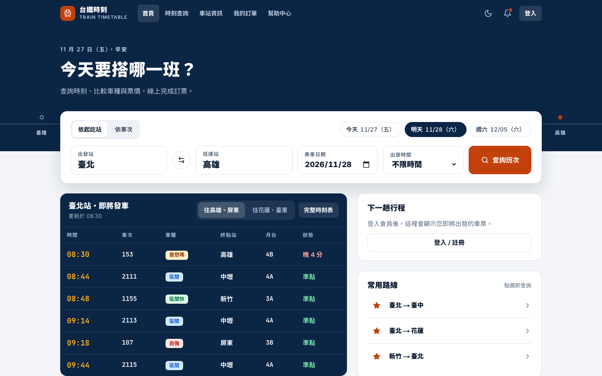
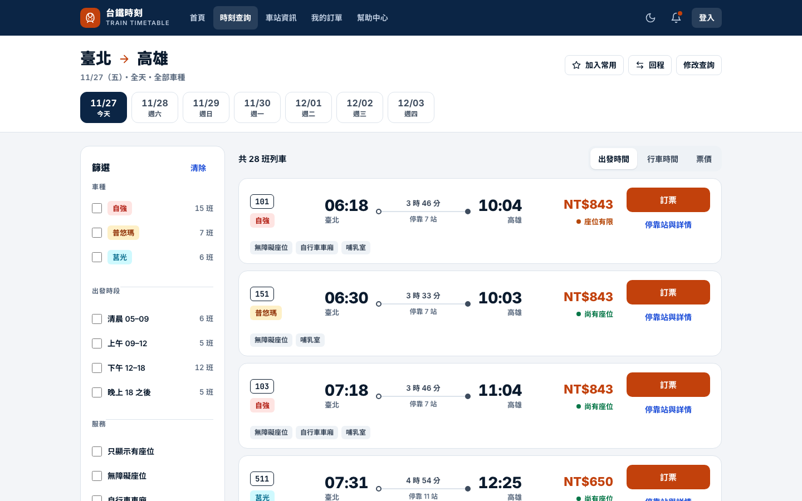
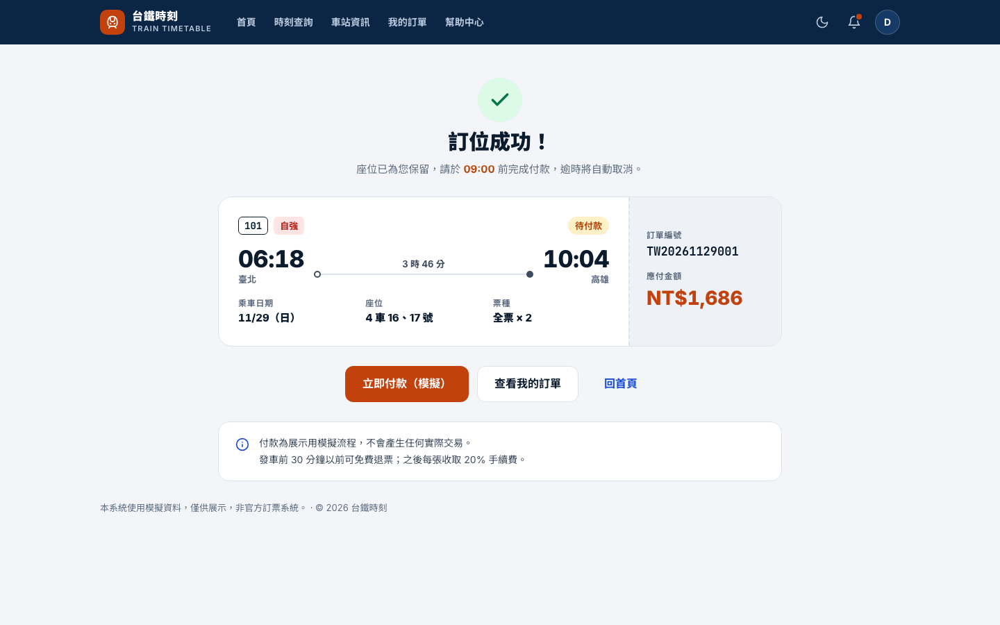
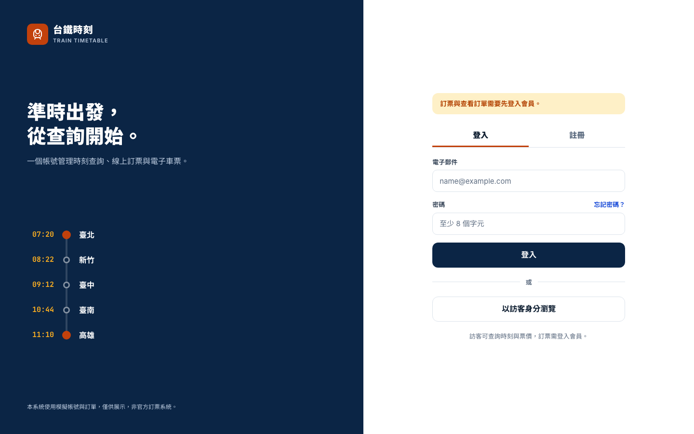
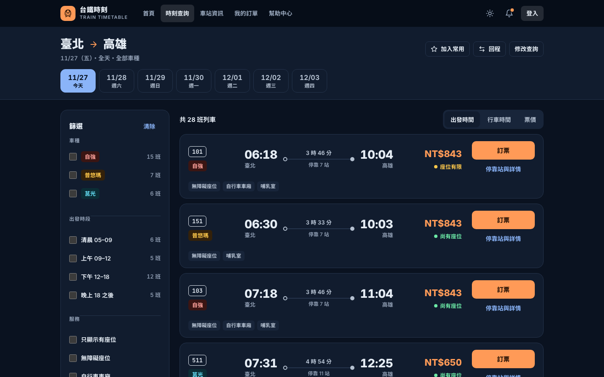
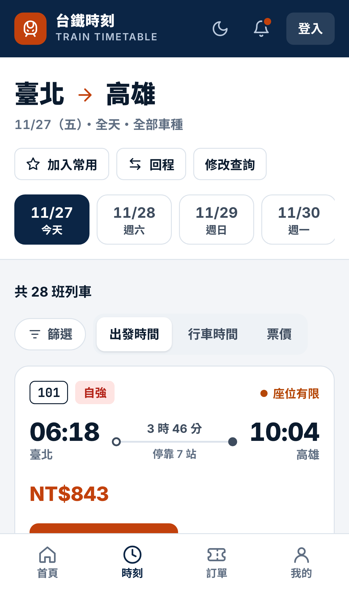

# 台鐵時刻（Trainstation Time Table System）

這是一個查詢火車時刻、模擬線上訂票的網站。你可以查班次、比較車種和票價、看每一站的停靠時間，也可以體驗訂票、付款、退票的流程。電腦和手機都能用，也有深色模式。

**網站入口：** [https://trainstation-time-table-gr925.vercel.app](https://trainstation-time-table-gr925.vercel.app)

> [!IMPORTANT]
> **使用前請先閱讀**
> - 這是個人作品集專案，**不是官方訂票系統**，與臺灣鐵路公司（臺鐵）及交通部沒有任何關係，也未獲其授權或背書。
> - **不會產生真的車票，也不會真的收費。** 訂票、付款、退票都是模擬流程。
> - **時刻表是模擬資料**，可能和實際班次不同，請不要拿來安排真實行程。要搭車請以臺鐵官方網站或車站公告為準。
> - **請不要輸入真實密碼或個人資料。** 登入是模擬的，任何電子郵件和密碼都能登入，建議用 `name@example.com` 這類範例信箱。

## 網站畫面

以下畫面都使用模擬資料與示範帳號，沒有任何真實個人資料。

| 首頁：查詢班次與即將發車 | 查詢結果 |
|---|---|
|  |  |

| 車次詳情：停靠站與票價 | 車站資訊：發車看板、轉乘、設施 |
|---|---|
|  |  |

| 填寫訂票資料 | 訂位成功 |
|---|---|
|  |  |

| 我的訂單 | 會員登入 |
|---|---|
|  |  |

| 深色模式 | 幫助中心 |
|---|---|
|  |  |

| 手機版首頁 | 手機版查詢結果 | 手機版車次詳情 |
|---|---|---|
|  |  |  |

## 你可以做什麼

- **查時刻**
  - 輸入出發站和抵達站查詢；也可以直接輸入車次號碼。
  - 可選日期（今天起 28 天內）和出發時間。
  - 結果可依車種、出發時段、服務篩選，也可依出發時間、行車時間或票價排序。
- **看車次詳情**：每一站的到站和開車時間，你搭乘的區間會特別標示，並列出全票、孩童票、敬老票、愛心票的票價。
- **訂票（模擬）**：選擇乘客人數與票種（每筆最多 6 位）、座位偏好（不指定、靠窗、靠走道）和取票聯絡人。
- **管理訂單（模擬）**：付款、取消、退票、列印車票，也可以用訂單編號、車次或車站搜尋訂單。
- **車站資訊**：依北部、中部、南部、東部瀏覽車站，查看兩個方向的即將發車班次、轉乘交通和站內設施。
- **常用路線與最近查詢**：在查詢結果按「加入常用」收藏路線，首頁可一鍵再次查詢。
- **幫助中心**：常見問題分類，並可用關鍵字搜尋問題和答案。
- **深色模式與手機版**：右上角的月亮／太陽圖示可切換深色模式；手機上會出現底部分頁列。

## 怎麼使用

### 1. 查詢班次
1. 在首頁點「出發站」和「抵達站」，可以輸入中文或英文站名搜尋，例如「台中」或「Hualien」。
2. 選擇日期（可點「今天」、「明天」、「週六」快速選擇）和出發時間。
3. 按「查詢班次」。
4. 想查特定車次，切換到「依車次」，輸入車次號碼即可。

### 2. 查看停靠站
在查詢結果點「停靠站與詳情」，就能看到這班車每一站的時間和票價。

### 3. 訂票
1. 在查詢結果點「訂票」，或在車次詳情點「訂這班」。
2. 如果還沒登入，網站會先帶你到登入頁；登入後會自動回到原本的訂票頁。
3. 用「＋」「－」選擇各票種人數，選擇座位偏好，確認聯絡人資料後按「確認訂票」。
4. 訂位成功後，請在 **30 分鐘內**按「立即付款（模擬）」，超過時間訂單會自動取消。

> 區間車、區間快車是自由座，不需要訂位，所以不會出現「訂票」按鈕。

### 4. 管理訂單
到「我的訂單」可以依狀態查看訂單：

| 狀態 | 意思 | 可以做的事 |
|---|---|---|
| 待付款 | 已訂位，還沒付款 | 付款、取消訂單 |
| 已付款 | 已完成付款 | 列印車票、退票 |
| 已完成 | 乘車日期已過 | 查看 |
| 已退款 | 已退票 | 查看 |
| 已取消 | 已取消或超過付款期限 | 查看 |

## 常見問題

**這個網站的時刻表是真的嗎？**
目前顯示的是模擬時刻表，和實際班次可能不同。網頁最下方會標示目前的資料來源。

**訂票會扣款嗎？會拿到車票嗎？**
不會。付款和車票都是模擬的，不會產生任何真實交易或車票。

**為什麼訂票要登入？訪客可以做什麼？**
訂票和查看訂單需要登入會員；訪客可以查時刻、看車站資訊和幫助中心。登入是模擬的，任何電子郵件和密碼都能登入。

**我的訂單存在哪裡？**
只存在你目前使用的瀏覽器裡。換一台裝置、換瀏覽器、使用無痕視窗或清除瀏覽資料後，訂單就不會出現。第一次使用時，「我的訂單」會先放幾筆示範訂單。

**網站顯示的是哪裡的時間？**
一律是臺灣時間。

## 隱私與安全

- **伺服器不會儲存你輸入的資料。** 訂單、常用路線、最近查詢都只存在你的瀏覽器。
- **密碼不會被傳送或保存。** 登入時輸入的密碼只用來檢查長度，不會離開你的瀏覽器。即便如此，仍請不要輸入你在其他網站使用的密碼。
- **登入狀態**只保存姓名和電子郵件，放在只有本網站能讀取的 cookie 中，並不是真正的帳號。
- **登入後只會回到本網站的頁面**，不會被帶到其他網站。

## 回報問題

- **一般問題或建議**：請到 [GitHub Issues](https://github.com/s0912758806p/Trainstation-time-table-system/issues) 留言。
- **安全漏洞**：請不要公開發表。請使用 [私下回報漏洞](https://github.com/s0912758806p/Trainstation-time-table-system/security/advisories/new)，只有你和專案維護者看得到內容。

## 給開發者

以下內容給想在自己電腦上執行或修改這個專案的人。

### 技術架構

- **網站框架**：Next.js 16（App Router、Server Components、Server Actions、`proxy.ts` 路由保護）、React 19、TypeScript（strict）
- **樣式**：Tailwind CSS 4，設計 token 以 CSS 變數定義在 `app/globals.css`
- **元件**：Radix UI（Dialog、Popover）
- **資料**：TDX（運輸資料流通服務）API，只在伺服器端呼叫；沒有金鑰時使用模擬資料
- **測試**：Vitest（單元測試）、Playwright（端對端測試）
- **部署**：Vercel

### 在自己電腦上執行

需要 Node.js 20.9+。

```bash
npm install
cp .env.example .env.local   # 選用：填入 TDX 金鑰
npm run dev                  # 開啟 http://localhost:3000
```

其他指令：`npm run build`、`npm start`、`npm run lint`、`npm run typecheck`、`npm test`、`npm run test:watch`、`npm run test:e2e`、`npm run screenshots`。

### 環境變數

| 變數 | 使用位置 | 用途 |
|---|---|---|
| `TDX_CLIENT_ID` / `TDX_CLIENT_SECRET` | 僅伺服器端 | TDX OAuth 金鑰。留空時使用模擬資料。**不可加上 `NEXT_PUBLIC_` 前綴**，否則金鑰會被打包進前端。 |
| `USE_MOCK` | 僅伺服器端 | 設為 `true` 時，即使有金鑰也強制使用模擬資料。 |

- **申請金鑰**：到 [TDX 運輸資料流通服務](https://tdx.transportdata.tw/) 申請；部署到 Vercel 時，在專案設定的 Environment Variables 填入。
- **不要提交金鑰**：除了 `.env.example`，所有 `.env*` 檔都已被 git 忽略。
- **標示來源**：使用 TDX 資料時，頁尾會標示資料來源（交通部 TDX 運輸資料流通服務），以符合 TDX 的資料使用規範。
- **`vercel.json`**：固定使用 Next.js 框架，避免 Vercel 後台舊的 Vite 設定影響建置。

### 資料來源與備援

```
Server Components / Server Actions
        │
   lib/data/index.ts  ── 有設定 TDX？ ──是──▶ lib/tdx（token 快取＋查詢，快取 30 秒～1 天）
        │                    │                       │ 失敗或缺資料
        │                    否                      ▼
        └──────────────────────────────────▶ lib/mock（決定性的模擬時刻表）
```

- **拿不到的資料一律改用模擬資料**，頁面不會因為 TDX 而壞掉。每個資料函式都回傳 `{ data, source }`。
  - **整筆改用模擬**（`source: 'mock'`，並記錄 `[data] … 改用模擬資料`）：TDX 回傳錯誤、空清單或格式不符，或查無該車次、行程、車站。
  - **只補缺的欄位**（`source` 仍為 `'tdx'`）：票價查不到時依模擬路網里程估算；座位狀態 TDX 不提供，一律用模擬值。
- **TDX 端點**集中在 `lib/tdx/client.ts`（`TDX_PATHS`）。目前只確認過 token 端點；時刻表、票價、即時看板的路徑依 TDX v3 文件撰寫，取得金鑰後請對照 TDX Swagger 驗證。票價對應（`pickFare`）在驗證前是推估。
- **模擬時刻表是決定性的**：同一個車次永遠是同樣的車種與停靠站；座位狀態與誤點依「車次＋日期」產生。
- **瀏覽器儲存**：訂單、最近查詢、常用路線、已讀公告存在 `localStorage`（`lib/stores`）。
- **登入狀態**：`ts_session` cookie，由 `app/actions/session.ts` 的 Server Actions 設定。

### 安全設計

- **金鑰只在伺服器端**：`lib/tdx/client.ts` 匯入 `server-only`，金鑰不會送到瀏覽器。CI 與建置都不需要任何 secret，一律使用模擬資料。
- **Session cookie**：`ts_session` 設定 `HttpOnly`、`SameSite=Lax`，正式環境加上 `Secure`；內容只有顯示名稱、電子郵件與訪客旗標，不是憑證。
- **路由保護**：`proxy.ts` 會把沒有會員身分的訪客，從 `/booking`、`/orders`、`/account` 導向登入頁。
- **防止開放式重新導向**：登入後的 `?next=` 只接受本站路徑（`lib/safeNext.ts`），會擋下外部網址、`//host`、`/\host` 與控制字元；單元測試與端對端測試都有涵蓋。
- **CI 權限**：workflow 只用內建的 `GITHUB_TOKEN`，每個 job 只給需要的最小權限，沒有個人存取權杖。repo 已開啟 secret scanning、push protection 與私下回報漏洞。

### 測試

```bash
npm test             # 單元測試（Vitest），跑一次
npm run test:watch   # 檔案變更時自動重跑
```

單元測試放在 `test/`，不需要 TDX 金鑰或瀏覽器：

- **資料備援**（`test/data-fallback.test.ts`）：TDX 失敗、空清單、格式錯誤、查無車次時改用模擬資料；缺票價時以里程估算。
- **TDX 用戶端與轉換**：token 快取、`USE_MOCK`、HTTP 錯誤、跨午夜時刻表、票價挑選。
- **模擬時刻表**：結果固定、查詢排序、票價、看板方向（PR #5 的回歸測試）。
- **日期工具**：例如快速日期「週六」不會和「明天」重複。
- **訂單**：訂單編號順序、30 分鐘付款期限、逾時取消、退票與取消、瀏覽器無法儲存時的處理。
- **登入**：`proxy.ts` 路由保護、session 解析、登入後重新導向的安全檢查。
- **文件同步**（`test/docs-freshness.test.ts`）：本 README 寫到的指令、環境變數、Node 版本、workflow 清單，必須和 `package.json`、`.env.example`、程式碼及 `.github/workflows/` 一致；README 沒同步更新，測試就會失敗。

#### 端對端測試（Playwright）

```bash
npx playwright install chromium   # 第一次執行前安裝瀏覽器
npm run test:e2e                  # 先建置，再以 USE_MOCK=true 在 :3100 啟動並用 Chromium 測試
```

測試放在 `e2e/`，以臺灣時區對正式建置操作真實瀏覽器：

- **查詢**（`e2e/search.spec.ts`）：車站選擇（「台」可找到「臺」）、交換起訖站、起訖站相同的錯誤、快速日期、依車次查詢、查詢結果 → 車次詳情。
- **訂票**（`e2e/booking.spec.ts`）：未登入 → 登入 → 回到訂票頁 → 加一位乘客 → 訂票 → 付款 → 我的訂單（重新整理後仍在）→ 退票；另測表單驗證與取消待付款訂單。
- **其他頁面**（`e2e/site.spec.ts`）：路由保護、訪客不會被來回導向、登入後不會被導向外部網站、登入表單驗證、深色模式重新整理後保留、車站看板、幫助中心搜尋、404 頁面。
- **手機版**（`e2e/layout.mobile.spec.ts`，Pixel 7）：主要頁面沒有水平捲動，底部分頁列可切換頁面。

**無效車次頁的狀態碼是 200**：`/trains/<無效車次>` 會顯示 404 畫面並加上 `noindex`，但因為 `(site)/loading.tsx` 會先開始串流，狀態碼已送出 200。這是 Next.js 的既定行為，測試會檢查畫面與 `noindex`。

**CI 失敗時**：到該次執行下載 `playwright-report` 報告查看。

#### 重新產生截圖

```bash
npm run screenshots          # 先建置，再輸出 docs/screenshots/*.png
```

`scripts/screenshots.mjs` 會：

- 以 `USE_MOCK=true` 啟動正式建置。
- 用 `scripts/fake-clock.mjs`（只在截圖時載入）把時間固定在隔天 08:30（臺灣時間），讓看板排滿班次、每次截圖結果一致。
- 擷取桌面版、深色模式與手機版畫面。
- 用示範帳號 `demo@example.com` 登入，截圖中不會出現真實個資。

### 分支與部署

```
功能分支 ──(Auto Pull Request)──▶ PR 到 dev ──(手動合併)──▶ dev
dev ──(Dev to Release：先跑 CI，通過才自動開 PR 並合併)──▶ release   → Vercel 預覽
release ──(手動開 PR 並合併)──▶ main                                  → Vercel 正式站
```

`.github/workflows/` 裡的 workflow：

| 檔案 | 何時執行 | 做什麼 |
|---|---|---|
| `ci.yml` | 推送到 `dev` 以外的任何分支、手動 | lint、型別檢查、`npm test`、`npm run build`、`npm run test:e2e`（使用模擬資料，不需要金鑰） |
| `auto-pull-request.yml` | 推送到功能分支 | 還沒有 PR 時，自動開 PR 到 `dev` |
| `dev-to-release.yml` | 推送到 `dev`、手動 | 先執行 `ci.yml`；通過後才開 `dev` → `release` 的 PR 並合併 |

- **權杖**：所有 workflow 都用內建的 `GITHUB_TOKEN`。需要在 repo 的 Settings → Actions → General 開啟「Allow GitHub Actions to create and approve pull requests」。
- **release 不會重跑 CI**：用 `GITHUB_TOKEN` 完成的合併不會觸發 `push`，所以自動合併到 `release` 時不會再跑一次 CI。Vercel 透過自己的 GitHub app 部署，不受影響。
- **`ci.yml` 沒有 `pull_request` 觸發**：同一個 repo 的分支在推送時就已檢查，結果會顯示在 PR 上；機器人開的 PR 觸發的執行只會卡在等待核准。代價是 fork 來的 PR 不會自動跑 CI。
- **跳過自動合併到 release**：在 `dev` 的 commit 訊息加上 `[skip-release]`。也可以手動執行 Actions → Dev to Release → Run workflow。

### 專案結構

```
app/
  (site)/            有頂部選單與手機分頁列的頁面
    page.tsx         首頁：查詢、即將發車、下一趟行程、常用路線、公告
    search/          查詢結果（?from&to&date&after）
    trains/[no]/     車次詳情（?date&from&to）
    booking/         訂票表單；booking/done/[id] 訂位成功
    orders/          我的訂單
    stations/[id]/   車站資訊
    help/            幫助中心
    account/         會員中心
  login/             登入／註冊／訪客
  actions/session.ts 模擬登入與登出（Server Actions）
  globals.css        設計 token（亮色／深色）與元件樣式
components/          TopBar、SiteChrome、SearchForm、StationPicker、ResultsList、DepartureBoard、BookingForm、OrdersView…
lib/
  data/              資料存取入口（TDX → 模擬資料備援）
  tdx/               TDX 用戶端與資料轉換
  mock/              模擬路網（車站、路線、班次樣板）與時刻表產生器
  stores/            以 localStorage 保存的瀏覽器端資料（訂單、偏好）
  safeNext.ts        登入後重新導向的本站路徑檢查
  board.ts           發車看板工具（方向標籤）
  format.ts、trainTypes.ts、types.ts、faq.ts、notices.ts、stationInfo.ts
proxy.ts             保護 /booking、/orders、/account
test/                Vitest 單元測試
e2e/                 Playwright 端對端測試
scripts/             截圖產生器
docs/screenshots/    本 README 使用的截圖
```

## 授權與聲明

- 本專案原始碼以 MIT 授權釋出，詳見 [LICENSE](./LICENSE)。
- MIT 授權只涵蓋本專案的原始碼。鐵路、車站名稱及任何官方標誌，皆屬於各自的權利人。
- 使用 TDX 資料時，須遵守 TDX 的資料使用規範。

## 作者

Gorman
